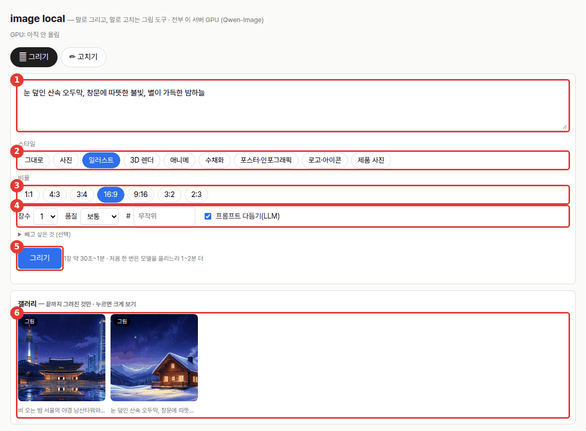
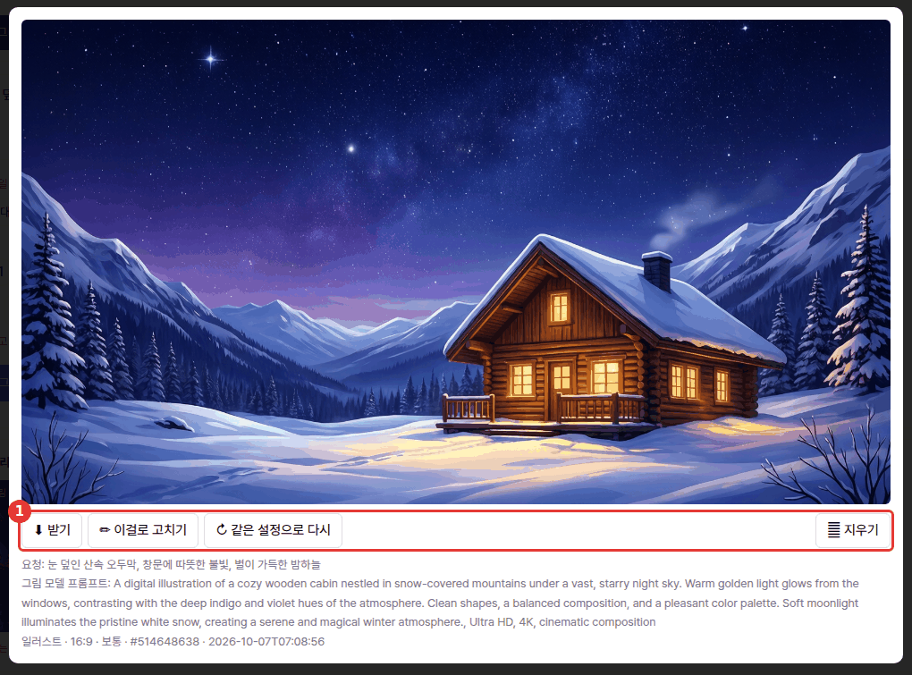
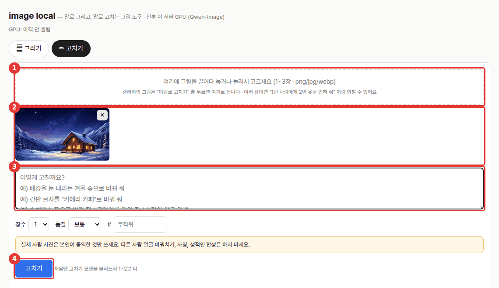

# image-local — 말로 그리기 · 말로 고치기 (폐쇄망 로컬)

말로 그리고 말로 고치는 범용 그림 도구입니다 — 글로 설명하면 그림을 그리고(**Qwen-Image-2512**), 있는 그림을 말로 고칩니다(**Qwen-Image-Edit-2509**). 한글 글자·사진/일러스트/포스터/로고. 포트 `8792`.



## 무엇을 하나

모델·LLM 모두 이 서버에서 돌고 밖으로 나가는 요청은 없습니다(처음 한 번 모델 다운로드 제외).

- **그리기**: 스타일 9종(그대로·사진·일러스트·3D 렌더·애니메·수채화·포스터/인포그래픽·로고/아이콘·제품 사진), 비율 7종(1:1 1328², 16:9 1664×928 …), 1~4장, 품질 빠르게 20 / 보통 30 / 고품질 50 단계, 번호(seed)
- **한글 글자**: 따옴표 안 문구를 그림에 씀(짧은 제목·간판 수준). 글자 스타일엔 "Ultra HD, 4K" 같은 꼬리말을 붙이지 않음(그림에 글자로 찍혀 나옴)
- **프롬프트 다듬기**: 로컬 LLM(포털 기본 `gemma4:31b`)이 한국어 요청을 자세한 영어 프롬프트로 — 따옴표 문구는 그대로
- **고치기**: 그림 1~3장 + 지시("배경을 겨울로", "2번 옷을 1번 사람에게") → 결과 약 1MP
- **갤러리**: 끝난 것만, 받기·이걸로 고치기·같은 설정으로 다시·지우기(`.trash/` 로 이동)

## 사용 방법

**그리기** (위 화면)

1. **요청**(①)을 한국어로 편하게 씁니다. 그림 안에 넣을 글자는 따옴표로 감쌉니다 — 예) 포스터, 제목 "안전이 먼저입니다".
2. **스타일**(②)과 **비율**(③)을 고릅니다.
3. **장수·품질·번호(#)·프롬프트 다듬기(LLM)**(④)를 정합니다. 같은 번호면 같은 그림이 나오고, 비우면 매번 새로 그립니다. 빼고 싶은 것(네거티브)은 그 아래 접힌 칸에 적습니다.
4. **그리기**(⑤)를 누르면 진행률이 보이고 결과가 바로 아래에 뜹니다. 보통 품질 1장 약 25초, 처음 한 번은 모델을 GPU 에 올리느라 1~2분 더 걸립니다.
5. **갤러리**(⑥)의 그림을 누르면 크게 보기 창이 열립니다.



6. 크게 보기 창(①)에서 받기·이걸로 고치기·같은 설정으로 다시·지우기를 하고, 아래에서 원래 요청·그림 모델에 실제로 보낸 프롬프트·설정을 확인합니다.

**고치기**



1. 그림을 끌어다 놓거나 눌러서 고릅니다(①, 1~3장 · png/jpg/webp). 갤러리에서 **이걸로 고치기**를 누르면 그 그림이 바로 들어옵니다.
2. 올라간 그림(②)을 확인합니다. ✕ 로 뺄 수 있고, 여러 장이면 "1번 사람에게 2번 옷을 입혀 줘" 처럼 합칠 수 있습니다.
3. **어떻게 고칠지**(③)를 씁니다 — "배경을 눈 내리는 겨울 숲으로", "수채화 느낌으로", 간판 글자 바꾸기 등.
4. **고치기**(④)를 누릅니다. 처음엔 고치기 모델을 올리느라 1~2분 더 걸립니다.

## 예시

포털 경유로 실제 실행한 결과입니다(2026-10-07, 실행 `2026-10-07-d95b2b`, 위 크게 보기 화면의 그림).

- **입력**: "눈 덮인 산속 오두막, 창문에 따뜻한 불빛, 별이 가득한 밤하늘" · 스타일 일러스트 · 16:9 · 보통(30단계) · 1장 · 프롬프트 다듬기 켬
- **다듬어진 프롬프트**(LLM): "A digital illustration of a cozy wooden cabin nestled in snow-covered mountains under a vast, starry night sky. Warm golden light glows from the windows … serene and magical winter atmosphere., Ultra HD, 4K, cinematic composition"
- **출력**: 1664×928 PNG 1장 · 번호 #514648638 (같은 번호·설정이면 같은 그림)

## 설치·실행
```bash
bash setup.sh          # venv(torch는 드라이버에 맞는 CUDA 빌드) → selftest → http://localhost:8792
bash setup.sh stop
venv/bin/python app.py --cli "비 오는 밤 우동집, 간판 \"우동\"" -o udon.png --style photo --ratio 16:9 [--quality fast|normal|high]
```
포털(agent-page-portal)에서는 `그림 생성` 으로 켜고 끕니다.

## 구조
- `app.py` — stdlib 서버(SSE). 프리셋·LLM 다듬기·실행 기록(`WORKSPACE/<날짜-id>/meta.json, img_N.png`)
- `worker.py` — venv 의 GPU 작업 프로세스(127.0.0.1:8793, NDJSON). 필요할 때 app 이 띄움. 모델은 한 번에 하나만 올림,
  올릴 때마다 여유 메모리가 가장 큰 GPU 를 고름(`gpu_pick.py`), 모자라면 CPU 오프로드로 자동 전환, `GPU_IDLE_UNLOAD_S`(600초) 안 쓰면 내림
- 측정(H100, bf16, 통째로 GPU): 1664×928 30단계 **약 24초/장**, 첫 로드 +30초. GPU 메모리 약 60GB. 오프로드 모드는 약 65초/장
- 모델 캐시: Qwen-Image-2512 약 58GB(아바타 스튜디오와 같은 캐시) + Qwen-Image-Edit-2509 약 58GB (`~/.cache/huggingface`)

env: `PORT`(8792) `WORKER_PORT`(8793) `IMAGE_DEVICE`(비우면 자동, 고정하려면 cuda:N) `GPU_POOL` `GPU_IDLE_UNLOAD_S`(600) `GPU_PICK_HOLD_S`(600) `OFFLOAD`(auto/1/0) `GEN_MODEL` `EDIT_MODEL` `LLM_API`(ollama/openai) `LLM_BASE_URL` `LLM_MODEL`(기본 `qwen3:8b`, 포털로 띄우면 `gemma4:31b`) `WORKSPACE`(기본 `./_workspace`)

## 주의
실존 인물·유명인, 동의 없는 실제 사람 사진 편집, 사칭, 선정적인 그림은 만들지 마세요. 서버는 모든 요청에 NSFW 네거티브 프롬프트를 붙입니다.

## 출처·감사 (Credits)

- 그리기 모델 [Qwen/Qwen-Image-2512](https://huggingface.co/Qwen/Qwen-Image-2512), 고치기 모델 [Qwen/Qwen-Image-Edit-2509](https://huggingface.co/Qwen/Qwen-Image-Edit-2509) — Alibaba Qwen 팀, Apache-2.0 (가중치는 동봉하지 않음, 처음 쓸 때 Hugging Face 에서 받음)
- 실행: [PyTorch](https://github.com/pytorch/pytorch) (BSD-3), [diffusers](https://github.com/huggingface/diffusers)·[transformers](https://github.com/huggingface/transformers)·[accelerate](https://github.com/huggingface/accelerate) (Apache-2.0), [Pillow](https://github.com/python-pillow/Pillow) (MIT-CMU)
- **프롬프트 다듬기 LLM** — 기본 배포는 [Ollama](https://github.com/ollama/ollama) (MIT) 위의 Google [Gemma](https://ai.google.dev/gemma) `gemma4:31b` — 모델 이용 조건은 Gemma 배포처 참고.
- 이 도구는 [agent-page-portal](https://github.com/gggg8657/agent-page-portal) 에 연결해 쓰도록 만들었습니다(단독 실행도 됨).

저작권 표기·전체 목록은 `NOTICE` 를 보세요.

## 라이선스

MIT (`LICENSE`) · © 2026 gggg8657 — 모델 가중치는 각 배포처의 라이선스(Apache-2.0)를 따릅니다.
